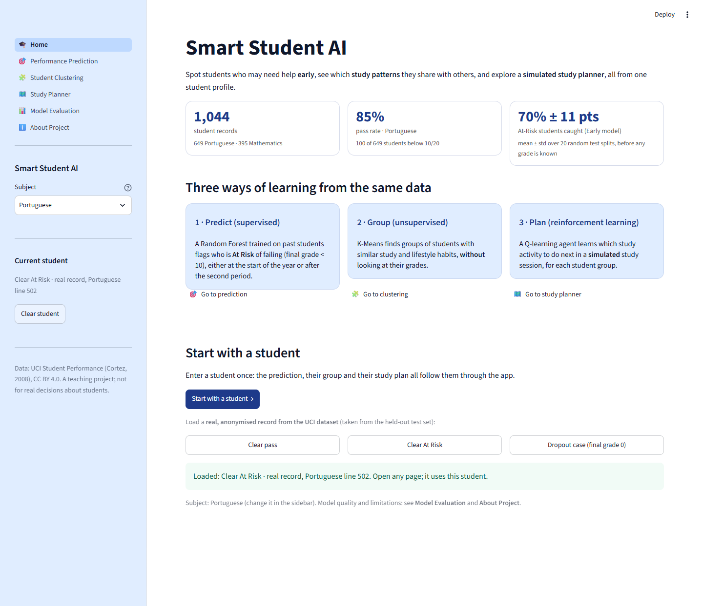
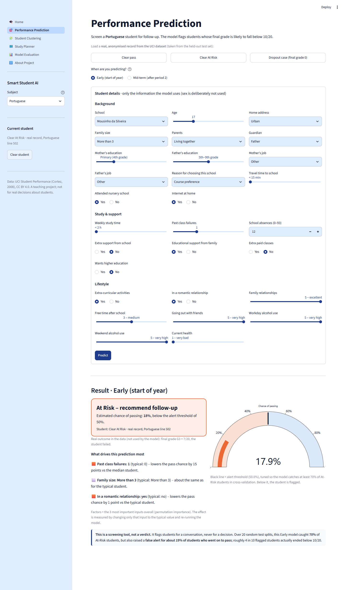
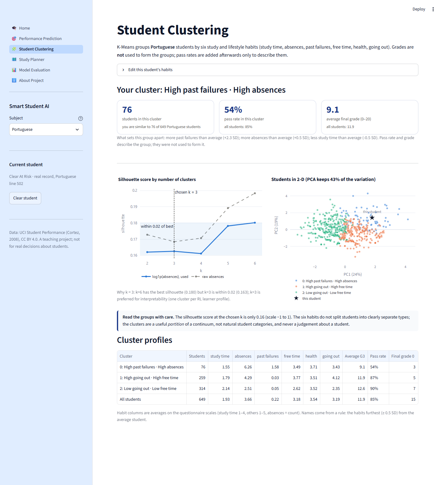
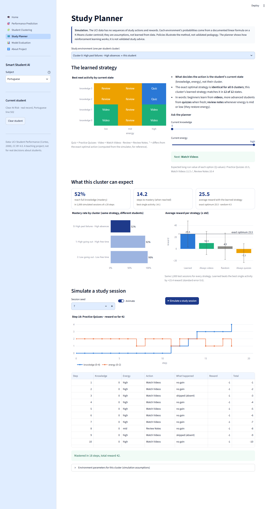

# Smart Student AI

**Intelligent student performance prediction and personalised learning**, using three kinds of machine learning
on the UCI Student Performance dataset:

1. **Predict (supervised):** a Random Forest flags students who are **At Risk** of failing (final grade below
   10/20), either at the start of the year or after the second grading period.
2. **Group (unsupervised):** K-Means finds groups of students with similar study and lifestyle habits,
   without looking at their grades.
3. **Plan (reinforcement learning):** a Q-learning agent learns which study activity to do next in a
   **simulated** study session, with one environment per student group.

One student entered in the app flows through all three: risk prediction → their group → a study strategy.

**Live demo:** <link>



## Features

- **Screening, not a verdict.** The At-Risk alert uses a threshold tuned on training data to catch about 70%
  of At-Risk students. The app shows the matching false-alert rate next to every prediction.
- **Explained predictions.** Each prediction shows the 3 most important factors for that student, with a
  plain-English effect ("lowers the pass chance by 15 points vs the median student").
- **Real example students.** Three anonymised records from the held-out test set: a clear pass, a clear At Risk
  student, and a dropout with final grade 0.
- **Honest evaluation.** Headline numbers are the mean ± std over 20 random train/test splits. The app also
  covers fairness by sex, the data issues found (dropouts with 0 recorded absences) and how they were handled.
- **Reproducible.** One script regenerates every model, metric and figure with fixed seeds; two runs produce
  identical files.
- Works on a laptop, a projector and a phone.

| Prediction | Clustering | Study planner |
|---|---|---|
|  |  |  |

More screenshots, including phone width, are in [reports/screenshots/](reports/screenshots/).

## Setup

Python **3.11** (the same version as on Streamlit Community Cloud).

```bash
git clone <repo-url> Smart-Student-AI
cd Smart-Student-AI
python -m venv .venv
.venv\Scripts\activate            # Windows  (macOS/Linux: source .venv/bin/activate)
pip install -r requirements.txt   # app only;  use requirements-dev.txt to also run the tests
```

## How to run the app

```bash
streamlit run app.py               # opens http://localhost:8501
```

The data, the trained models and `reports/metrics.json` are committed, so the app runs without any training.
If a model file is missing, the page says so and points to `python scripts/train_all.py`.

| Page | What it shows |
|---|---|
| Home | What the system does, key numbers, a "Start with a student" button |
| Performance Prediction | Student form (Early or Mid-term), At-Risk screening result with probability gauge, top 3 factors |
| Student Clustering | The student's cluster, silhouette by k, PCA map with the student marked, cluster profiles |
| Study Planner | The learned study strategy, the cluster's expected outcome, strategy comparison, animated simulated session |
| Model Evaluation | 20-split headline metrics, the saved model's split, fairness by sex, data issues and fixes, RL learning rates |
| About Project | Data, license and citation, methods, limitations, future work |

**One student flows through the app.** Enter a student once on the Prediction page, or load one of the three
example records. The Clustering and Study Planner pages then use the same student. To open any page with an
example already loaded, add `?example=pass`, `?example=at_risk` or `?example=dropout` to the URL (optionally
with `&subject=mat`), for example `http://localhost:8501/prediction?example=dropout`.

## How to retrain

Everything in `models/` and `reports/` is produced by one script, with fixed seeds (42). The committed files
are exactly what it produces, so you only need to retrain after changing code, data or `src/config.py`.

```bash
python scripts/train_all.py           # everything except the 20-split evaluation (~7–10 min on 4 cores)
python scripts/train_all.py --full    # also rerun the 20-split repeated evaluation (~30 min extra)
```

| Step | Script | Produces | Time* |
|---|---|---|---|
| 1. data | `scripts/download_data.py` + schema validation | `data/student-{mat,por}.csv` (downloaded only if missing) | seconds |
| 2. eda | `scripts/eda.py` | figures 01–06, `metrics.json["eda"]` | seconds |
| 3. supervised | `scripts/train_supervised.py` | `models/clf_{mat,por}_{early,midterm}.joblib`, figures 07–12, `metrics.json["supervised"]` | ~6–8 min |
| 4. clustering | `scripts/train_clustering.py` | `models/kmeans_{mat,por}.joblib`, figures 14–16, `metrics.json["clustering"]` | seconds |
| 5. rl | `scripts/train_rl.py` | `models/q_tables.joblib`, figures 17–20, `metrics.json["rl"]` | ~1 min |
| 6. repeated (`--full` only) | `scripts/repeated_splits.py` | figure 13, `metrics.json["supervised_repeated_splits"]` | ~30 min |

\*On a 4-core laptop. Without `--full`, the existing `metrics.json["supervised_repeated_splits"]` is left as
it is. Rerun with `--full` after any change that affects the supervised models. The steps stop at the first
failure, and each script can also be run on its own. RL reads the saved K-Means models, so rerun clustering
before RL whenever clustering changes.

**Checking reproducibility:** `scripts/fingerprint.py` hashes `metrics.json` and the predictions of every saved
model.

```bash
python scripts/fingerprint.py before.json
python scripts/train_all.py
python scripts/fingerprint.py after.json --compare before.json   # prints IDENTICAL or the differences
```

## How to test

```bash
pip install -r requirements-dev.txt
pytest                                # ~1 min; data, supervised, clustering, RL and app smoke tests
```

The app tests use `streamlit.testing.v1.AppTest` and cover:
- every page loading for both subjects, with and without a student;
- the example students, and a prediction from the form;
- the student carrying over to the Clustering and Planner pages;
- missing models or metrics, invalid link parameters and a corrupt stored student.

Screenshots are regenerated with `scripts/take_screenshots.py`. It's an optional tool that needs
`pip install playwright`, Google Chrome and a running app; it is not part of the requirements.

## Project structure

```text
app.py                     entry point: navigation + Home page
pages/                     Performance Prediction, Student Clustering, Study Planner, Model Evaluation, About
src/
  config.py                paths, seeds, feature lists, RL coefficients, project info
  data.py                  loading, target, schema validation, data dictionary (FEATURE_SPEC)
  preprocessing.py         feature sets per scenario, ColumnTransformer, monotonic constraint
  supervised.py            training, threshold tuning, evaluation, predict()
  unsupervised.py          K-Means pipeline, k selection, cluster profiles and names, assign_cluster()
  rl_env.py                simulated study environment (Gymnasium-style reset/step)
  rl_agent.py              Q-learning, evaluation, exact optimum, recommend(), simulate_episode()
  metrics_io.py            safe read/merge of reports/metrics.json
  ui.py                    shared Streamlit helpers: sidebar, cached loaders, shared student, styling
scripts/                   download_data, eda, train_supervised, train_clustering, train_rl,
                           repeated_splits, train_all, fingerprint, take_screenshots
data/                      student-mat.csv, student-por.csv (UCI, CC BY 4.0)
models/                    4 classifiers, 2 K-Means pipelines, Q-tables (~15 MB)
reports/                   metrics.json (every number in the app), figures/, screenshots/
tests/                     pytest suite
DECISIONS.md               every decision that differs from or adds to PROJECT_SPEC.md, with reasons
```

## Results

All numbers are the **mean ± std over 20 random stratified 80/20 train/test splits**
(`metrics.json["supervised_repeated_splits"]`). "At Risk" = final grade below 10/20.

| Subject | Scenario | Model (own tuned threshold) | Macro F1 | At-Risk recall | At-Risk precision | ROC-AUC | False alerts per test set |
|---|---|---|---|---|---|---|---|
| Portuguese | Early | Logistic Regression | 0.65 ± 0.04 | 0.75 ± 0.10 | 0.35 ± 0.05 | 0.82 ± 0.04 | 27.9 of 110 |
| Portuguese | Early | **Random Forest (saved)** | 0.69 ± 0.03 | 0.70 ± 0.11 | 0.40 ± 0.04 | 0.85 ± 0.03 | 20.7 of 110 |
| Portuguese | Mid-term | Logistic Regression | 0.82 ± 0.03 | 0.84 ± 0.08 | 0.61 ± 0.06 | 0.95 ± 0.02 | 11.0 of 110 |
| Portuguese | Mid-term | **Random Forest (saved)** | 0.86 ± 0.03 | 0.81 ± 0.08 | 0.73 ± 0.07 | 0.96 ± 0.01 | 6.0 of 110 |
| Mathematics | Early | Logistic Regression | 0.57 ± 0.04 | 0.69 ± 0.11 | 0.41 ± 0.04 | 0.67 ± 0.06 | 25.4 of 53 |
| Mathematics | Early | **Random Forest (saved)** | 0.56 ± 0.04 | 0.70 ± 0.09 | 0.41 ± 0.04 | 0.66 ± 0.06 | 26.1 of 53 |
| Mathematics | Mid-term | Logistic Regression | 0.90 ± 0.04 | 0.90 ± 0.06 | 0.83 ± 0.07 | 0.97 ± 0.01 | 4.9 of 53 |
| Mathematics | Mid-term | **Random Forest (saved)** | 0.90 ± 0.03 | 0.93 ± 0.04 | 0.83 ± 0.06 | 0.96 ± 0.02 | 5.0 of 53 |

- **Early** (start of year, no grades) is the useful scenario. It catches about **70% of At-Risk students**,
  but only about 4 in 10 flagged students actually fail, so it is a screening tool.
  - Both models use the same threshold rule (out-of-fold on training data, ≥ 70% At-Risk recall, never
    below 0.5). Compared on the same 20 splits, the Random Forest is clearly better for Portuguese (macro F1
    +0.035 Early / +0.042 Mid-term, and 7.2 / 5.0 fewer false alerts per test set; Logistic Regression
    catches slightly more At-Risk students at the cost of those extra alerts), slightly better for Mathematics
    Mid-term, and tied for Mathematics Early.
- **Mid-term** is far more accurate, mainly because the period 2 grade is almost the final grade.
- **Clustering:** Portuguese k = 3, Mathematics k = 5, chosen by silhouette with a preference for 3 when close.
  Silhouettes are low (0.16–0.17), so the clusters partition a continuum of habits rather than finding natural
  types. Pass rates differ strongly between groups: 21% in Mathematics "High past failures" vs 67% overall.
- **Study planner (simulation):** in all 8 cluster environments the learned strategy beats the best single
  activity by +11.3 to +18.0 reward, and matches the exact optimal action in 10–12 of 12 states.
  - The optimal strategy turned out to be the same for every cluster: the student's current knowledge and
    energy decide the action, and the cluster changes the expected outcome (mastery 41%–100%).

## Limitations

- **Old, local data:** two Portuguese schools in 2005–2006; results may not generalise.
- **Small samples:** 395 Mathematics and 649 Portuguese students, so results vary between splits. The single
  split of the saved models is unusually hard for Portuguese Early (macro F1 0.54 vs 0.70 on average), which
  is why the 20-split numbers are the headline.
- **Self-reported categories:** study time, free time, going out etc. are questionnaire categories, not
  measurements.
- **Dropouts:** 53 students have a final grade of 0 and 0 recorded absences. They most likely left or did not
  sit the exam. They are kept as At Risk, and the model is constrained so absences can only lower the pass
  chance, so it cannot learn that perfect attendance is risky.
- **Fairness:** sex is not a model input, but At-Risk recall differs between girls and boys in some models
  (e.g. Mathematics Early: 65% vs 77%, counts pooled over the 20 test sets). Groups are small and the estimate
  is uncertain.
- **Simulated RL:** the data has no record of study actions and their effects. The study environments are
  assumptions derived from cluster averages; the planner illustrates the method and is not validated
  teaching advice.
- **Clusters describe habits, not people**, and are never a judgement of a student.

The reasoning behind every design decision, with the numbers, is in [DECISIONS.md](DECISIONS.md).

## Data, citation and license

**Dataset:** Cortez, P. (2008). *Student Performance* [Dataset]. UCI Machine Learning Repository.
https://doi.org/10.24432/C5TG7T. Licensed under
[CC BY 4.0](https://creativecommons.org/licenses/by/4.0/); the two CSV files in `data/` are redistributed
unchanged with this attribution.

**Original study:** Cortez, P. & Silva, A. (2008). *Using Data Mining to Predict Secondary School Student
Performance.* Proc. 5th FUBUTEC, pp. 5–12.

**Libraries:** scikit-learn, Streamlit, Plotly, pandas, NumPy, Matplotlib, joblib.
**Reference:** Sutton, R. & Barto, A. (2018). *Reinforcement Learning: An Introduction* (2nd ed.). MIT Press.
